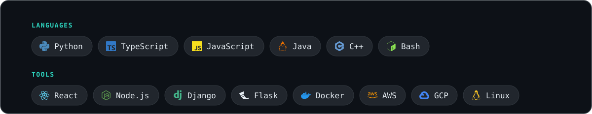

<picture>
  <source media="(prefers-color-scheme: dark)" srcset="./assets/header-dark.svg" />
  <source media="(prefers-color-scheme: light)" srcset="./assets/header-light.svg" />
  
</picture>

  🌐 <a href="https://anubabajide.github.io">anubabajide.github.io</a> &nbsp;·&nbsp; 📍 London

### 👋 Hey, I'm Aanu

Software engineer based in London. I like building things end to end, from the API to the pixels, and I'm happiest when a hard problem turns into a simple one.

<!-- TODO: add 1–2 lines about what you're working on / interested in right now -->

### 🧰 Stack

<picture>
  <source media="(prefers-color-scheme: dark)" srcset="./assets/stack-dark.svg" />
  <source media="(prefers-color-scheme: light)" srcset="./assets/stack-light.svg" />
  
</picture>

### 🛠️ Selected projects

| | Project | What it is |
|---|---|---|
| 🏥 | [**epp-me**](https://github.com/anubabajide/epp-me) | Hospital-locating service for web and mobile · React + TypeScript |
| 🍽️ | [**Forkify**](https://github.com/anubabajide/Forkify) · [live](https://anubabajide.github.io/Forkify/) | Recipe search app · JavaScript |
| 💁 | [**WhoAreU-Flask**](https://github.com/anubabajide/WhoAreU-Flask) | REST API authentication with Flask · Python |
| 🎄 | [**Advent-of-Code**](https://github.com/anubabajide/Advent-of-Code) | Advent of Code solutions · Python |
| 📚 | [**Data-Structures-and-Algorithms**](https://github.com/anubabajide/Data-Structures-and-Algorithms) | Classic DS&A problems, worked through · Python |

### ⚡ Recently active

<!-- RECENT:START -->
- [**epp-me**](https://github.com/anubabajide/epp-me) — A hospital locating service fro web and mobile TypeScript · Feb 2026
- [**coursera**](https://github.com/anubabajide/coursera) Jupyter Notebook · Aug 2023
- [**Forkify**](https://github.com/anubabajide/Forkify) — A very simple recipe searching app JavaScript · Jan 2023
- [**mutual-enigma**](https://github.com/anubabajide/mutual-enigma) — Frontend for jiji like website for users to buy and sell JavaScript · Dec 2022
- [**refactored-amala**](https://github.com/anubabajide/refactored-amala) — Backend for jiji like website for users to buy and sell Python · Dec 2022
<!-- RECENT:END -->

<picture>
  <source media="(prefers-color-scheme: dark)" srcset="./assets/stats-dark.svg" />
  <source media="(prefers-color-scheme: light)" srcset="./assets/stats-light.svg" />
  
</picture>

Header, stats and “recently active” are regenerated daily by <a href="./.github/workflows/update-profile.yml">a GitHub Action</a>.
